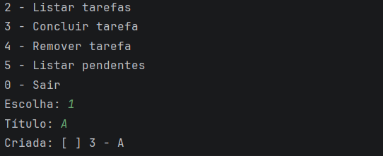
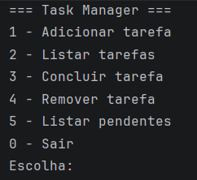

# Java Task Manager

Gerenciador de tarefas de terminal em Java puro, sem frameworks. Projeto de estudo para praticar orientação a objetos, coleções e arquivos, versionado com Git em commits pequenos.





Além do menu de terminal, há uma janela em Swing:

[Interface gráfica](Docs/Viewer.png)


## Funcionalidades
- Adicionar, listar, concluir e remover tarefas
- Listar só as tarefas pendentes
- Salvar as tarefas em arquivo e carregá-las ao abrir o programa

## Como rodar
1. Clone o repositório:
```bash
   git clone https://github.com/GuilhermeProgram/java-task-manager.git
```
2. Abra a pasta no IntelliJ IDEA (ou outra IDE Java).
3. Execute a classe `Main`.

## Estrutura
| Arquivo | Responsabilidade |
|---|---|
| `Task.java` | Modelo de uma tarefa (id, título, status) |
| `TaskManager.java` | Lista de tarefas e operações, incluindo salvar e carregar |
| `Main.java` | Menu interativo no terminal |

## O que pratiquei
- Classes, encapsulamento e sobrecarga de construtores
- `ArrayList` e laços `for`
- Leitura e escrita de arquivos com `java.nio.file`
- Tratamento de entrada inválida com `try/catch`

## Próximos passos
- Testes automatizados
- Editar o título de uma tarefa
